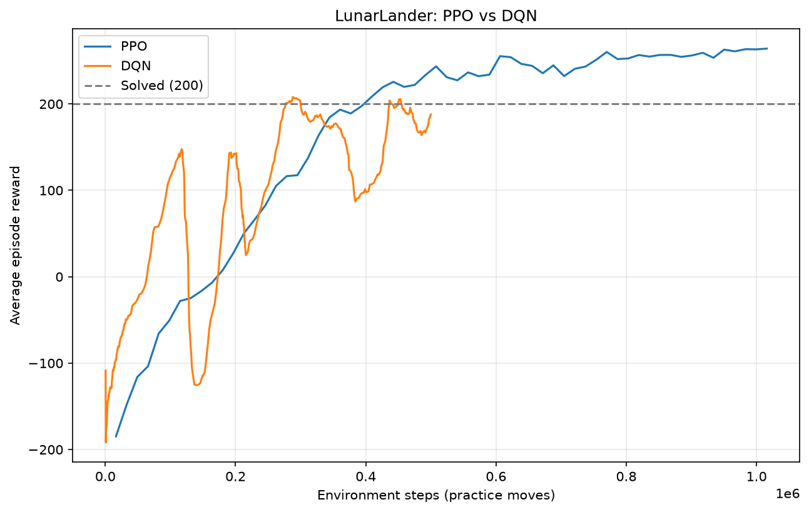

# Rocket-Simulation: Teaching a Lander to Land with Reinforcement Learning

I built this project to learn reinforcement learning (RL) from zero. A small rocket has to land on a pad in the **LunarLander** environment (Gymnasium + Box2D). I tried to fly it myself, wrote a rule-based pilot, and then trained two RL agents, **PPO** and **DQN**, and compared how they learn.

## Results



*Average episode reward vs. environment steps (practice moves). A score of 200 counts as "solved".*

### Final performance (20 test episodes, greedy actions)

| Agent | Training steps | Mean ± std | Min | Max | Episodes ≥ 200 |
|---|---|---|---|---|---|
| PPO | 1,000,000 | 266 ± 13 | 246 | 294 | 20 / 20 |
| DQN | 500,000 | 226 ± 84 | 53 | 324 | 13 / 20 |
| Me, playing by hand | n/a | -204 (33 games) | -477 | 18 | 0 / 33 |

### What the curves show

- **PPO learns steadily.** It climbs from about -185 to about 265, crosses the solved line near 400,000 steps, and stays above it.
- **DQN learns faster per step but is unstable.** It reaches about 200 near 280,000 steps, well before PPO, but it collapses three times (around 120k, 210k and 380k steps) and recovers each time.
- **The same pattern appears in testing.** PPO's 20 landings were all within about 50 points of each other. DQN has the single best landing (324), but 7 of its 20 episodes scored below 200, two of them near failures.
- **A likely explanation for DQN's dips:** as it improves, its replay buffer fills with successful landings and the old crash experience is pushed out, so it temporarily forgets what to avoid. This is the standard explanation for this shape, and I have not isolated it with a separate experiment.

## Demo videos

- PPO landing:

https://github.com/user-attachments/assets/901fce1d-313c-4e02-8506-8c1015905923


- DQN landing:
  
https://github.com/user-attachments/assets/0c202af7-96a4-4097-8a9c-66384a5dc7f6

## How the problem works

- **State (8 numbers):** x and y position, x and y speed, tilt angle, spin speed, and whether each leg touches the ground.
- **Actions (4):** do nothing, fire the left engine, fire the main engine, fire the right engine.
- **Reward:** points for moving toward the pad, slowing down and staying upright; points for leg contact; a small penalty for every engine firing; +100 for a safe landing and -100 for a crash.
- **Policy:** a small neural network (8 inputs, hidden layers, 4 outputs). Training adjusts its weights so that high-scoring actions become more likely.

I started with the baselines to understand why learning is needed:

1. **Manual flying.** I averaged about -204 over 33 games, with a best of 18.3.
2. **A hand-coded if/else pilot** (`rules_pilot.py`). The rules fought each other and it could not land reliably.

## Project structure

| File | Purpose |
|---|---|
| `play.py` | Fly the lander yourself with the keyboard |
| `rules_pilot.py` | Rule-based pilot with no learning |
| `peek.py` | Print the policy network and its action probabilities |
| `train_ppo.py` | Train a PPO agent |
| `train_dqn.py` | Train a DQN agent |
| `evaluate.py` | Score a trained model over several episodes |
| `watch_trained.py` | Watch a trained agent land and print each score |
| `record_rl.py` | Record videos of a trained agent |
| `plot_results.py` | Build `learning_curves.png` from the training logs |
| `ppo_lunar.zip`, `dqn_lunar.zip` | Trained models |
| `demo/` | Demo videos |

## Run it yourself

Python 3.10 to 3.12 is recommended.

```bash
python -m venv rl-env
rl-env\Scripts\activate          # Windows (use: source rl-env/bin/activate on macOS/Linux)
pip install swig
pip install "gymnasium[box2d]" stable-baselines3 tensorboard moviepy matplotlib
```

```bash
python play.py            # try landing it yourself (W = main engine, A / D = side engines)
python train_ppo.py       # train PPO
python train_dqn.py       # train DQN
python watch_trained.py   # watch a trained model (set the model path inside the script)
python plot_results.py    # regenerate the learning curves from ./logs
```

To see the training curves live, run `tensorboard --logdir logs`. The `logs/` and `checkpoints/` folders are not committed, so they appear after you train. The hyperparameters for each agent are in its training script.

## Limitations

- **One training run per algorithm.** RL results vary with random seeds, so these numbers describe what I observed, not a general ranking of PPO and DQN. Several seeds per method would be needed to compare them properly.
- **Small evaluation.** Each model was tested on 20 episodes, and I report the population standard deviation.
- **Not tuned extensively.** Neither agent was heavily tuned, so a better-configured DQN could behave differently.

## Ideas for next steps

- Run several seeds per algorithm and plot the average with a shaded range.
- Test DQN with a larger replay buffer to see whether the collapses shrink.
- Change gravity or add wind and check whether the trained agents still land.
- Move to a continuous-control environment such as BipedalWalker and write one algorithm from scratch.

## Tools

Python, [Gymnasium](https://gymnasium.farama.org/) (LunarLander, Box2D), [Stable-Baselines3](https://stable-baselines3.readthedocs.io/), PyTorch, TensorBoard, Matplotlib.

## Author

Shaik Husamuddin ([@Sk-husamuddin](https://github.com/Sk-husamuddin)) · [Portfolio](https://husamuddin-portfolio.vercel.app)
